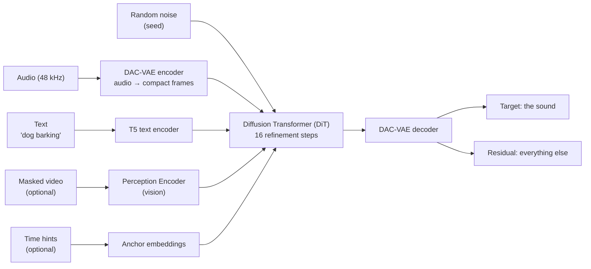

# Models guide

Audio Forensic runs **SAM-Audio** (Meta, 2025). You name a sound, and the model splits the recording into two tracks: that sound (the **target**) and everything else (the **residual**).

## Versions in this app

| Version | Size | Weights file | GPU memory | Speed on a 6 GB RTX 4050 |
|---|---|---|---|---|
| Small · FP16 (PyTorch) | 0.6B | 5.1 GB (official, FP32 → FP16 on load) | ~2.4 GB | ~4.5× faster than real time |
| Large · FP8 (PyTorch) | 3B | 4.6 GB (built locally from FP16) | ~4.3 GB | ~2× slower than real time |
| Large · FP16 (PyTorch) | 3B | 7.4 GB (community FP16 export) | ~4.0 GB, weights streamed from RAM | ~4× slower than real time |
| Small · Q8 (GGUF) | 0.6B | 2.4 GB | 6.8 GB ¹ | not measured here |
| Small · BF16 (GGUF) | 0.6B | 2.8 GB | 7.4 GB ¹ | not measured here |
| Large · Q8 (GGUF) | 3B | 5.0 GB | 9.4 GB ¹ | not measured here |

- Speeds are for a 35 s clip with the default chunk length, after the model has loaded (loading takes 10–15 s, once).
- ¹ The GGUF publisher's numbers for a 15 s clip in one pass on a 32 GB GPU. Shorter chunks and memory-bounded mode lower them.
- A **base** model (1B) also exists; it isn't in this app yet.

## Which one should I use?

- **Quick look, or long recordings:** Small · FP16.
- **Best quality on a 6 GB GPU:** Large · FP8. Its output matched FP16 at a correlation of 0.999 in our test.
- **Large · FP16:** the same quality as FP8 but slower here, because the weights don't fit in the GPU and are streamed from RAM.
- **No NVIDIA GPU:** the GGUF versions run on the CPU, or on any Vulkan GPU.
- Large isn't better at everything. In Meta's ratings, it wins on separating one speaker and on professional music, while small wins on general sound effects.

## Precision in plain words

| Format | Bytes per weight | What it means |
|---|---|---|
| FP32 | 4 | The original training precision. Large and slow to move around. |
| FP16 / BF16 | 2 | Half the size, practically the same results. The usual GPU format. |
| FP8 | 1 (+ one scale per row) | Stored in 8 bits and converted back to FP16 just before each use. Half of FP16's memory, at a small extra cost per step. |
| Q8 (GGUF) | ~1 | 8-bit blocks for audio.cpp. Normalization layers and biases stay at full precision. |

- Smaller formats save memory and loading time. They never add quality.
- GPU memory = weights + working memory for the current chunk. Longer chunks need more working memory.

## How the model works

- **DAC-VAE codec:** turns audio into a short sequence of frames (25 per second) and back. Small and fast.
- **T5:** turns your description into numbers the model understands.
- **Perception Encoder:** looks at the masked video frames. It's loaded only when you add a visual reference (~1 GB).
- **Time hints** mark frames where the sound is present (+) or absent (−).
- **DiT:** the big part (0.6B in small, ~2.9B in large). Starting from noise, it refines the target and residual step by step, guided by everything above. The *Diffusion steps* setting is the number of passes; the *Seed* fixes the starting noise.

## How the app handles long audio

- Audio is stored in blocks, so YouTube links and long files play within seconds.
- The model sees one **chunk** at a time. Neighbouring chunks overlap by the **crossfade** time and are blended, so you don't hear joins.
- Only one isolation runs at a time. The model stays loaded between runs, and **Stop** unloads it.

## Requirements at a glance

| | Minimum | Comfortable |
|---|---|---|
| GPU (NVIDIA) | 4 GB for small | 6 GB for large FP8; 8 GB+ to keep large FP16 in GPU memory |
| RAM | 8 GB | 16 GB (large FP16 streams ~6 GB of weights from RAM) |
| Disk | ~10 GB (small) | ~35 GB (all versions) |
